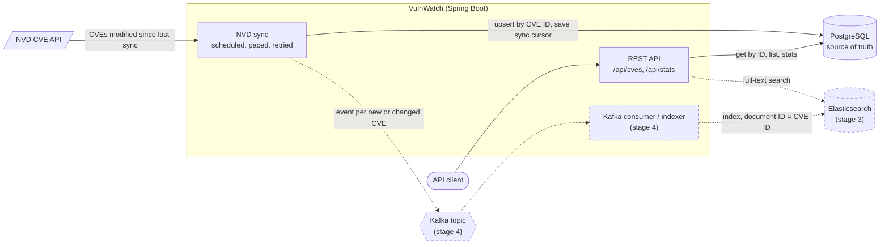

# VulnWatch

A CVE feed aggregator built with Java 21 and Spring Boot 3. It polls the public
[NVD CVE API](https://nvd.nist.gov/developers/vulnerabilities), keeps every CVE in PostgreSQL,
and exposes a REST API on top. Kafka and Elasticsearch are added in later stages.

The project is built in four stages. **Stages 1 and 2 are done**; the rest are planned.

| Stage | What it adds | Status |
|---|---|---|
| 1 | REST API and PostgreSQL (Flyway schema, get by ID, filtered list, stats) | done |
| 2 | Scheduled NVD ingestion with retry/backoff, upsert by CVE ID | done |
| 3 | Elasticsearch index and full-text search | planned |
| 4 | Kafka between ingestion and indexing | planned |

## Architecture

Solid lines exist today. Dashed parts arrive in later stages.



How a sync run works:

```
NvdSyncScheduler     wakes up on a timer and starts a sync
     |
NvdSyncService       works out the time window: from the saved cursor to now
     |                 for each page of results:
     |-- NvdClient         one paced HTTP request, retried on 429 / 5xx / network errors
     |-- NvdCveMapper      NVD JSON -> the fields VulnWatch stores
     |-- CveUpsertService  insert new, update changed, skip unchanged (one transaction per page)
     |
     saves the cursor (sync_state table) once the whole window is stored
```

How an API request works:

```
CveController   HTTP: parses and validates parameters, returns JSON
     |
CveService      business logic, runs inside a database transaction
     |
CveRepository   database access (Spring Data JPA) -> PostgreSQL
```

## Run it

You need [Docker Desktop](https://www.docker.com/products/docker-desktop/) running and an
internet connection. Nothing else.

```sh
docker compose up --build
```

This builds the app image and starts PostgreSQL and the app. Ten seconds after startup the
first sync begins and fetches every CVE that NVD modified in the last 7 days. That is usually a
few thousand CVEs and takes under a minute, because requests are spaced 6 seconds apart. When
you see this line in the log, the data is there:

```
NVD sync finished: window ... to ..., fetched 8801, created 8801, updated 0, unchanged 0
```

Then try these in a browser:

- <http://localhost:8080/api/stats?topVendors=5>
- <http://localhost:8080/api/cves?severity=critical&size=5>
- <http://localhost:8080/api/cves?vendor=microsoft>
- `http://localhost:8080/api/cves/<an ID from the list>`

After that the app syncs again every 2 hours, asking only for what changed since the last run.
Restarting is safe: the cursor is stored in the database, so the next sync continues from there.

Stop with `Ctrl+C`, then `docker compose down`. Add `-v` to also delete the database volume.

If port 8080 or 5432 is already taken on your machine, pick others:

```sh
APP_PORT=8081 POSTGRES_PORT=5433 docker compose up --build        # bash
$env:APP_PORT=8081; $env:POSTGRES_PORT=5433; docker compose up --build   # PowerShell
```

## NVD sync settings

The defaults live in `src/main/resources/application.yml` under `vulnwatch.nvd`. Each one can be
overridden with an environment variable, for example in the `environment:` block of the `app`
service in `compose.yaml`.

| Setting | Environment variable | Default | Meaning |
|---|---|---|---|
| `enabled` | `VULNWATCH_NVD_ENABLED` | `true` | Set to `false` to run without the background sync. |
| `api-key` | `NVD_API_KEY` | none | Optional [NVD API key](https://nvd.nist.gov/developers/request-an-api-key). |
| `poll-interval` | `VULNWATCH_NVD_POLL_INTERVAL` | `2h` | Pause between sync runs. NVD asks automated clients not to poll more often than this. |
| `initial-lookback` | `VULNWATCH_NVD_INITIAL_LOOKBACK` | `7d` | How far back the very first sync goes. |
| `request-interval` | `VULNWATCH_NVD_REQUEST_INTERVAL` | `6s` | Minimum gap between requests. NVD allows 5 requests per 30 seconds without a key and 50 with one, so with a key `1s` is fine. |
| `retry.max-attempts` | `VULNWATCH_NVD_RETRY_MAX_ATTEMPTS` | `5` | Attempts per request before the sync run gives up. |
| `retry.initial-backoff` | `VULNWATCH_NVD_RETRY_INITIAL_BACKOFF` | `6s` | Wait before the first retry. It doubles each time, up to `retry.max-backoff` (60 s). |

A request is retried only when NVD answers 429 or 5xx, or when the network fails. If a sync run
fails, nothing is lost: the cursor stays where it was and the next run fetches the same window
again.

Raising `initial-lookback` to load more history works, but it is slow without an API key: the
full NVD catalogue is over 300,000 CVEs at 2,000 per request.

Many recent CVEs have an empty `vendors` list and severity `UNKNOWN`. NVD adds affected
products and scores some time after a CVE is first published, and VulnWatch picks them up in a
later sync when NVD updates the record.

## API

All responses are JSON. Errors use the standard "problem detail" format (RFC 9457).

### `GET /api/cves/{id}`

Returns one CVE. The ID is case-insensitive. `404` if it is not stored, `400` if it does not
look like a CVE ID.

```json
{
  "id": "CVE-2021-44228",
  "description": "Apache Log4j2 2.0-beta9 through 2.15.0 ...",
  "severity": "CRITICAL",
  "cvssScore": 10.0,
  "cvssVersion": "3.1",
  "vulnStatus": "Analyzed",
  "publishedAt": "2021-12-10T10:15:09.143Z",
  "lastModifiedAt": "2026-08-11T19:33:44.513Z",
  "vendors": ["apache", "apple", "cisco"]
}
```

### `GET /api/cves`

Lists CVEs, newest first. Every parameter is optional and filters combine with AND.

| Parameter | Meaning | Example |
|---|---|---|
| `severity` | `CRITICAL`, `HIGH`, `MEDIUM`, `LOW`, `NONE` or `UNKNOWN` (any case) | `severity=high` |
| `vendor` | Exact vendor name as NVD writes it in CPE names (any case) | `vendor=apache` |
| `publishedFrom` | Published on or after this date (UTC) | `publishedFrom=2021-12-01` |
| `publishedTo` | Published on or before this date (UTC) | `publishedTo=2021-12-31` |
| `page` | Page number, starting at 0. Default 0 | `page=1` |
| `size` | Items per page, 1 to 100. Default 20 | `size=50` |

```json
{ "items": [ { "id": "CVE-2021-44228", "...": "..." } ], "page": 0, "size": 20, "totalItems": 8801, "totalPages": 441 }
```

Full-text search on the description arrives with Elasticsearch in stage 3.

### `GET /api/stats`

Counts per severity and the vendors with the most CVEs. `topVendors` sets how many vendors to
return (1 to 100, default 10).

```json
{
  "totalCves": 8801,
  "bySeverity": { "CRITICAL": 822, "HIGH": 3617, "MEDIUM": 3555, "LOW": 529, "NONE": 39, "UNKNOWN": 239 },
  "topVendors": [ { "vendor": "linux", "count": 979 }, { "vendor": "microsoft", "count": 292 } ]
}
```

## Develop

You need a JDK (21 is used to compile; Gradle finds it on its own) and Docker running.
On Windows `cmd` or PowerShell, write `.\gradlew.bat` instead of `./gradlew`.

| Command | What it does |
|---|---|
| `./gradlew test` | Runs the tests. They start a throwaway PostgreSQL container with Testcontainers and a fake NVD server, so they never call the real NVD. |
| `./gradlew bootTestRun` | Runs the app on port 8080 against a throwaway PostgreSQL container, syncing from the real NVD. Data is gone when you stop it. |
| `docker compose up -d postgres` then `./gradlew bootRun` | Runs the app from source against the Compose database, which keeps its data. |
| `./gradlew build` | Compiles, tests and builds the runnable jar in `build/libs/`. |

To look inside the database while Compose is running:

```sh
docker compose exec postgres psql -U vulnwatch -d vulnwatch
```

`select * from sync_state;` shows how far the sync has got.

## Project layout

```
build.gradle                       dependencies and build setup
compose.yaml, Dockerfile           the local stack and the app image
src/main/resources/
  application.yml                  configuration
  db/migration/V*.sql              Flyway database migrations
src/main/java/com/vulnwatch/
  VulnWatchApplication.java        entry point
  cve/                             the CVE entity, repository, read service, upsert service, controller
  nvd/                             NVD client, JSON mapping, sync service, scheduler, settings
  stats/                           the stats endpoint
  web/                             shared HTTP pieces: error handling, paging, converters
src/test/java/com/vulnwatch/       tests (JUnit 5, Testcontainers, MockMvc, WireMock)
```

The database user and password (`vulnwatch` / `vulnwatch`) are local development defaults.
They are fine on your own machine and not for a deployed instance.
