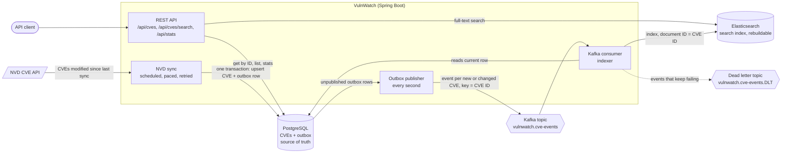

# VulnWatch

A CVE feed aggregator built with Java 21 and Spring Boot 3. It polls the public
[NVD CVE API](https://nvd.nist.gov/developers/vulnerabilities), keeps every CVE in PostgreSQL,
publishes an event to Kafka for each new or changed CVE, indexes those events into Elasticsearch
for full-text search, and exposes a REST API on top.

The project was built in four stages, all done:

| Stage | What it adds |
|---|---|
| 1 | REST API and PostgreSQL (Flyway schema, get by ID, filtered list, stats) |
| 2 | Scheduled NVD ingestion with retry/backoff, upsert by CVE ID |
| 3 | Elasticsearch index with an explicit mapping, full-text search with filters |
| 4 | Kafka between ingestion and indexing, with a transactional outbox |

## Architecture



How a change travels from NVD to the search index:

```
NvdSyncScheduler      wakes up on a timer and starts a sync
     |
NvdSyncService        works out the time window: from the saved cursor to now
     |                  for each page of results:
     |-- NvdClient          one paced HTTP request, retried on 429 / 5xx / network errors
     |-- NvdCveMapper       NVD JSON -> the fields VulnWatch stores
     |-- CveUpsertService   ONE transaction: insert new, update changed, skip unchanged,
     |                      and add an outbox row for every created or updated CVE
     saves the cursor (sync_state table) once the whole window is stored

OutboxPublisher       every second: locks a batch of outbox rows, sends them to Kafka,
     |                waits for the acknowledgement, deletes the rows
     v
Kafka topic           vulnwatch.cve-events (3 partitions, message key = CVE ID)
     |
CveEventListener      one event at a time: reads the CVE's current row from PostgreSQL
     |                and indexes it
     v
Elasticsearch         index "cves", document ID = CVE ID
```

How an API request works:

```
CveController   HTTP: parses and validates parameters, returns JSON
     |
CveService      business logic, runs inside a database transaction
     |
CveRepository   database access (Spring Data JPA) -> PostgreSQL
```

## Run it

You need [Docker Desktop](https://www.docker.com/products/docker-desktop/) running and an
internet connection. Nothing else.

```sh
docker compose up --build
```

This builds the app image and starts PostgreSQL, Kafka, Elasticsearch and the app. Elasticsearch
needs about 1 GB of memory and half a minute to start. Ten seconds after startup the first sync
begins and fetches every CVE that NVD modified in the last 7 days. That is usually a few thousand
CVEs and takes under a minute, because requests are spaced 6 seconds apart. You will see these
lines in the log:

```
NVD sync finished: window ... to ..., fetched 8801, created 8801, updated 0, unchanged 0
Published 2000 CVE events to Kafka
```

Events are indexed one at a time, so after a large first sync the search index catches up a
little later than the log line. Then try these in a browser:

- <http://localhost:8080/api/cves/search?q=remote+code+execution&size=5>
- <http://localhost:8080/api/cves/search?q=overflow&severity=critical>
- <http://localhost:8080/api/cves/search?q=%22sql+injection%22>
- <http://localhost:8080/api/stats?topVendors=5>
- <http://localhost:8080/api/cves?vendor=microsoft>
- `http://localhost:8080/api/cves/<an ID from the list>`

After that the app syncs again every 2 hours, asking only for what changed since the last run.
Restarting is safe: the sync cursor and the outbox are in the database, and Kafka remembers how
far the consumer has read.

Stop with `Ctrl+C`, then `docker compose down`. Add `-v` to also delete the database, Kafka and
search index volumes.

If port 8080, 5432, 9200 or 9094 is already taken on your machine, pick others:

```sh
APP_PORT=8081 POSTGRES_PORT=5433 ES_PORT=9201 KAFKA_PORT=9095 docker compose up --build        # bash
$env:APP_PORT=8081; $env:POSTGRES_PORT=5433; $env:ES_PORT=9201; $env:KAFKA_PORT=9095; docker compose up --build   # PowerShell
```

## Events and delivery guarantees

- **No change is lost between PostgreSQL and Kafka.** A CVE change and its outbox row are written
  in one database transaction (the transactional outbox pattern). The publisher deletes a row only
  after Kafka acknowledged the message.
- **Delivery is at-least-once.** If the app stops between "Kafka acknowledged" and "row deleted",
  the event is sent again. That is harmless: the consumer always indexes the CVE's current row
  under its CVE ID, so a repeated or out-of-order event just writes the same document again.
- **The event is a notification, not a copy of the data.** It carries the CVE ID, `CREATED` or
  `UPDATED`, and two timestamps:
  `{"cveId":"CVE-2021-44228","type":"UPDATED","lastModifiedAt":"...","occurredAt":"..."}`.
- **Ingestion does not depend on Elasticsearch.** While Elasticsearch is down, syncs keep running,
  events wait in Kafka, and the consumer retries with a growing pause (1 s up to 30 s) for as long
  as it takes. `GET /api/cves/search` answers `503` meanwhile; the other endpoints keep working.
- **Broken events do not block the rest.** A message that is not valid JSON goes straight to the
  dead letter topic `vulnwatch.cve-events.DLT`. Any other failure is retried twice and then sent
  there too.

To look at Kafka while the stack is running:

```sh
# consumer position and lag per partition
docker compose exec kafka /opt/kafka/bin/kafka-consumer-groups.sh --bootstrap-server localhost:9092 --describe --group vulnwatch-indexer

# read the events from the beginning (Ctrl+C to stop)
docker compose exec kafka /opt/kafka/bin/kafka-console-consumer.sh --bootstrap-server localhost:9092 --topic vulnwatch.cve-events --from-beginning --property print.key=true
```

In Git Bash on Windows, put `MSYS_NO_PATHCONV=1` in front of these commands, otherwise the
`/opt/...` path is rewritten to a Windows path. PowerShell and `cmd` need nothing extra.

## Search index

PostgreSQL is the source of truth. The Elasticsearch index `cves` is a copy built for searching
and can be thrown away at any time.

- The mapping is explicit and strict: `src/main/resources/elasticsearch/cve-index.json`.
  `description` is analysed English text; `severity` and `vendors` are exact keywords;
  unknown fields are rejected.
- The document ID is the CVE ID, so indexing a CVE again overwrites it instead of duplicating it.
- Elasticsearch is not allowed to create the `cves` index on its own (`action.auto_create_index`
  in `compose.yaml`), so the index can only ever exist with this mapping.
- On startup the app creates the index if it is missing. If the index holds fewer documents than
  PostgreSQL has CVEs, it rebuilds the whole index from PostgreSQL. If Elasticsearch is not
  reachable at startup, the app starts anyway and logs a warning.
- If the index disappears while the app is running, the next event recreates it with the correct
  mapping. Only CVEs that change afterwards are indexed until the next restart, which rebuilds
  everything.

To rebuild the index by hand, delete it and restart the app:

```sh
curl -X DELETE http://localhost:9200/cves
docker compose restart app
```

Elasticsearch runs without TLS and passwords here. That is for local development only.

## NVD sync settings

The defaults live in `src/main/resources/application.yml` under `vulnwatch.nvd`. Each one can be
overridden with an environment variable, for example in the `environment:` block of the `app`
service in `compose.yaml`.

| Setting | Environment variable | Default | Meaning |
|---|---|---|---|
| `enabled` | `VULNWATCH_NVD_ENABLED` | `true` | Set to `false` to run without the background sync. |
| `api-key` | `NVD_API_KEY` | none | Optional [NVD API key](https://nvd.nist.gov/developers/request-an-api-key). |
| `poll-interval` | `VULNWATCH_NVD_POLL_INTERVAL` | `2h` | Pause between sync runs. NVD asks automated clients not to poll more often than this. |
| `initial-lookback` | `VULNWATCH_NVD_INITIAL_LOOKBACK` | `7d` | How far back the very first sync goes. |
| `request-interval` | `VULNWATCH_NVD_REQUEST_INTERVAL` | `6s` | Minimum gap between requests. NVD allows 5 requests per 30 seconds without a key and 50 with one, so with a key `1s` is fine. |
| `retry.max-attempts` | `VULNWATCH_NVD_RETRY_MAX_ATTEMPTS` | `5` | Attempts per request before the sync run gives up. |
| `retry.initial-backoff` | `VULNWATCH_NVD_RETRY_INITIAL_BACKOFF` | `6s` | Wait before the first retry. It doubles each time, up to `retry.max-backoff` (60 s). |

A request is retried only when NVD answers 429 or 5xx, or when the network fails. If a sync run
fails, nothing is lost: the cursor stays where it was and the next run fetches the same window
again.

Raising `initial-lookback` to load more history works, but it is slow without an API key: the
full NVD catalogue is over 300,000 CVEs at 2,000 per request.

Many recent CVEs have an empty `vendors` list and severity `UNKNOWN`. NVD adds affected
products and scores some time after a CVE is first published, and VulnWatch picks them up in a
later sync when NVD updates the record.

## API

All responses are JSON. Errors use the standard "problem detail" format (RFC 9457).

### `GET /api/cves/{id}`

Returns one CVE. The ID is case-insensitive. `404` if it is not stored, `400` if it does not
look like a CVE ID.

```json
{
  "id": "CVE-2021-44228",
  "description": "Apache Log4j2 2.0-beta9 through 2.15.0 ...",
  "severity": "CRITICAL",
  "cvssScore": 10.0,
  "cvssVersion": "3.1",
  "vulnStatus": "Analyzed",
  "publishedAt": "2021-12-10T10:15:09.143Z",
  "lastModifiedAt": "2026-08-11T19:33:44.513Z",
  "vendors": ["apache", "apple", "cisco"]
}
```

### `GET /api/cves`

Lists CVEs, newest first. Every parameter is optional and filters combine with AND.

| Parameter | Meaning | Example |
|---|---|---|
| `severity` | `CRITICAL`, `HIGH`, `MEDIUM`, `LOW`, `NONE` or `UNKNOWN` (any case) | `severity=high` |
| `vendor` | Exact vendor name as NVD writes it in CPE names (any case) | `vendor=apache` |
| `publishedFrom` | Published on or after this date (UTC) | `publishedFrom=2021-12-01` |
| `publishedTo` | Published on or before this date (UTC) | `publishedTo=2021-12-31` |
| `page` | Page number, starting at 0. Default 0 | `page=1` |
| `size` | Items per page, 1 to 100. Default 20 | `size=50` |

```json
{ "items": [ { "id": "CVE-2021-44228", "...": "..." } ], "page": 0, "size": 20, "totalItems": 8801, "totalPages": 441 }
```

This endpoint reads from PostgreSQL.

### `GET /api/cves/search`

Full-text search on the description, answered by Elasticsearch. Results are ordered by relevance,
then newest first. The response has the same shape as `GET /api/cves`.

| Parameter | Meaning | Example |
|---|---|---|
| `q` | Required. Words that must all appear in the description. Word endings are ignored (`executing` finds `execution`). Use quotes for an exact phrase and `-` to exclude a word. | `q="sql injection" -wordpress` |
| `severity`, `vendor`, `publishedFrom`, `publishedTo` | Same filters as `GET /api/cves`. | `severity=critical` |
| `page`, `size` | Same as `GET /api/cves`. Only the first 10,000 results can be paged through; beyond that the request is rejected with `400`. | `page=2&size=50` |

A CVE becomes searchable about a second after it is indexed.

### `GET /api/stats`

Counts per severity and the vendors with the most CVEs. `topVendors` sets how many vendors to
return (1 to 100, default 10).

```json
{
  "totalCves": 8801,
  "bySeverity": { "CRITICAL": 822, "HIGH": 3617, "MEDIUM": 3555, "LOW": 529, "NONE": 39, "UNKNOWN": 239 },
  "topVendors": [ { "vendor": "linux", "count": 979 }, { "vendor": "microsoft", "count": 292 } ]
}
```

## Develop

You need a JDK (21 is used to compile; Gradle finds it on its own) and Docker running.
On Windows `cmd` or PowerShell, write `.\gradlew.bat` instead of `./gradlew`.

| Command | What it does |
|---|---|
| `./gradlew test` | Runs the tests. They start throwaway PostgreSQL, Kafka and Elasticsearch containers with Testcontainers and a fake NVD server, so they never call the real NVD. |
| `./gradlew bootTestRun` | Runs the app on port 8080 against throwaway PostgreSQL, Kafka and Elasticsearch containers, syncing from the real NVD. Data is gone when you stop it. |
| `docker compose up -d postgres kafka elasticsearch` then `./gradlew bootRun` | Runs the app from source against the Compose database, broker and search index, which keep their data. |
| `./gradlew build` | Compiles, tests and builds the runnable jar in `build/libs/`. |

To look inside the database while Compose is running:

```sh
docker compose exec postgres psql -U vulnwatch -d vulnwatch
```

`select * from sync_state;` shows how far the sync has got.

## Project layout

```
build.gradle                       dependencies and build setup
compose.yaml, Dockerfile           the local stack and the app image
src/main/resources/
  application.yml                  configuration
  db/migration/V*.sql              Flyway database migrations (CVEs, sync cursor, outbox)
  elasticsearch/cve-index.json     the Elasticsearch index mapping
src/main/java/com/vulnwatch/
  VulnWatchApplication.java        entry point
  cve/                             the CVE entity, repository, read service, upsert service, controller
  nvd/                             NVD client, JSON mapping, sync service, scheduler, settings
  events/                          the outbox table, the event record, the publisher that sends to Kafka
  search/                          index creation, the Kafka consumer that indexes, search service and endpoint
  stats/                           the stats endpoint
  web/                             shared HTTP pieces: error handling, paging, converters
src/test/java/com/vulnwatch/       tests (JUnit 5, Testcontainers, MockMvc, WireMock, Awaitility)
```

The database user and password (`vulnwatch` / `vulnwatch`) are local development defaults.
They are fine on your own machine and not for a deployed instance.
