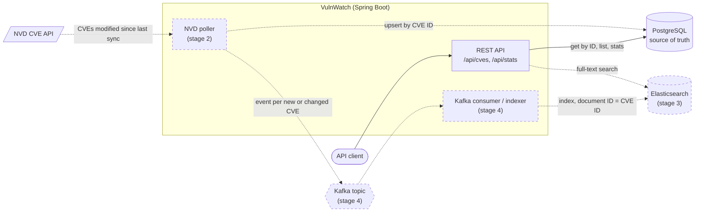

# VulnWatch

A CVE feed aggregator built with Java 21 and Spring Boot 3. It will poll the public
[NVD CVE API](https://nvd.nist.gov/developers/vulnerabilities), keep every CVE in PostgreSQL,
publish changes to Kafka, index them into Elasticsearch, and expose a REST API on top.

The project is built in four stages. **Stage 1 is done**; the rest are planned.

| Stage | What it adds | Status |
|---|---|---|
| 1 | REST API and PostgreSQL (Flyway schema, get by ID, filtered list, stats) | done |
| 2 | Scheduled NVD ingestion with retry/backoff, upsert by CVE ID | planned |
| 3 | Elasticsearch index and full-text search | planned |
| 4 | Kafka between ingestion and indexing | planned |

## Architecture

Solid lines exist today. Dashed parts arrive in later stages.



Inside the app, a request passes through three layers:

```
CveController   HTTP: parses and validates parameters, returns JSON
     |
CveService      business logic, runs inside a database transaction
     |
CveRepository   database access (Spring Data JPA) -> PostgreSQL
```

## Run it

You need [Docker Desktop](https://www.docker.com/products/docker-desktop/) running. Nothing else.

```sh
docker compose up --build
```

This builds the app image and starts PostgreSQL and the app. Wait for the log line
`Started VulnWatchApplication`, then open <http://localhost:8080/actuator/health>.
It should show `{"status":"UP"}`.

The database starts empty, because ingestion arrives in stage 2. To have something to look at,
load the sample data (33 real CVEs published on 2021-12-10, including Log4Shell). Run this in a
second terminal:

```sh
docker compose exec postgres sh -c "psql -U vulnwatch -d vulnwatch -f /sample-data/sample-cves.sql"
```

Loading it twice is harmless. Then try these in a browser:

- <http://localhost:8080/api/cves/CVE-2021-44228>
- <http://localhost:8080/api/cves?severity=critical&size=5>
- <http://localhost:8080/api/cves?vendor=apache>
- <http://localhost:8080/api/stats?topVendors=5>

Stop with `Ctrl+C`, then `docker compose down`. Add `-v` to also delete the database volume.

If port 8080 or 5432 is already taken on your machine, pick others:

```sh
APP_PORT=8081 POSTGRES_PORT=5433 docker compose up --build        # bash
$env:APP_PORT=8081; $env:POSTGRES_PORT=5433; docker compose up --build   # PowerShell
```

## API

All responses are JSON. Errors use the standard "problem detail" format (RFC 9457).

### `GET /api/cves/{id}`

Returns one CVE. The ID is case-insensitive. `404` if it is not stored, `400` if it does not
look like a CVE ID.

```json
{
  "id": "CVE-2021-44228",
  "description": "Apache Log4j2 2.0-beta9 through 2.15.0 ...",
  "severity": "CRITICAL",
  "cvssScore": 10.0,
  "cvssVersion": "3.1",
  "vulnStatus": "Analyzed",
  "publishedAt": "2021-12-10T10:15:09.143Z",
  "lastModifiedAt": "2026-08-11T19:33:44.513Z",
  "vendors": ["apache", "apple", "cisco"]
}
```

### `GET /api/cves`

Lists CVEs, newest first. Every parameter is optional and filters combine with AND.

| Parameter | Meaning | Example |
|---|---|---|
| `severity` | `CRITICAL`, `HIGH`, `MEDIUM`, `LOW`, `NONE` or `UNKNOWN` (any case) | `severity=high` |
| `vendor` | Exact vendor name as NVD writes it in CPE names (any case) | `vendor=apache` |
| `publishedFrom` | Published on or after this date (UTC) | `publishedFrom=2021-12-01` |
| `publishedTo` | Published on or before this date (UTC) | `publishedTo=2021-12-31` |
| `page` | Page number, starting at 0. Default 0 | `page=1` |
| `size` | Items per page, 1 to 100. Default 20 | `size=50` |

```json
{ "items": [ { "id": "CVE-2021-44228", "...": "..." } ], "page": 0, "size": 20, "totalItems": 33, "totalPages": 2 }
```

Full-text search on the description arrives with Elasticsearch in stage 3.

### `GET /api/stats`

Counts per severity and the vendors with the most CVEs. `topVendors` sets how many vendors to
return (1 to 100, default 10).

```json
{
  "totalCves": 33,
  "bySeverity": { "CRITICAL": 11, "HIGH": 9, "MEDIUM": 13, "LOW": 0, "NONE": 0, "UNKNOWN": 0 },
  "topVendors": [ { "vendor": "digi", "count": 4 }, { "vendor": "pluck-cms", "count": 4 } ]
}
```

## Develop

You need a JDK (21 is used to compile; Gradle finds it on its own) and Docker running.
On Windows `cmd` or PowerShell, write `.\gradlew.bat` instead of `./gradlew`.

| Command | What it does |
|---|---|
| `./gradlew test` | Runs the tests. They start a throwaway PostgreSQL container with Testcontainers. |
| `./gradlew bootTestRun` | Runs the app on port 8080 against a throwaway PostgreSQL container. Data is gone when you stop it. |
| `docker compose up -d postgres` then `./gradlew bootRun` | Runs the app from source against the Compose database, which keeps its data. |
| `./gradlew build` | Compiles, tests and builds the runnable jar in `build/libs/`. |

To look inside the database while Compose is running:

```sh
docker compose exec postgres psql -U vulnwatch -d vulnwatch
```

## Project layout

```
build.gradle                       dependencies and build setup
compose.yaml, Dockerfile           the local stack and the app image
sample-data/sample-cves.sql        optional demo data
src/main/resources/
  application.yml                  configuration
  db/migration/V1__*.sql           Flyway database migrations
src/main/java/com/vulnwatch/
  VulnWatchApplication.java        entry point
  cve/                             the CVE entity, repository, service and controller
  stats/                           the stats endpoint
  web/                             shared HTTP pieces: error handling, paging, converters
src/test/java/com/vulnwatch/       integration tests (JUnit 5, Testcontainers, MockMvc)
```

The database user and password (`vulnwatch` / `vulnwatch`) are local development defaults.
They are fine on your own machine and not for a deployed instance.
